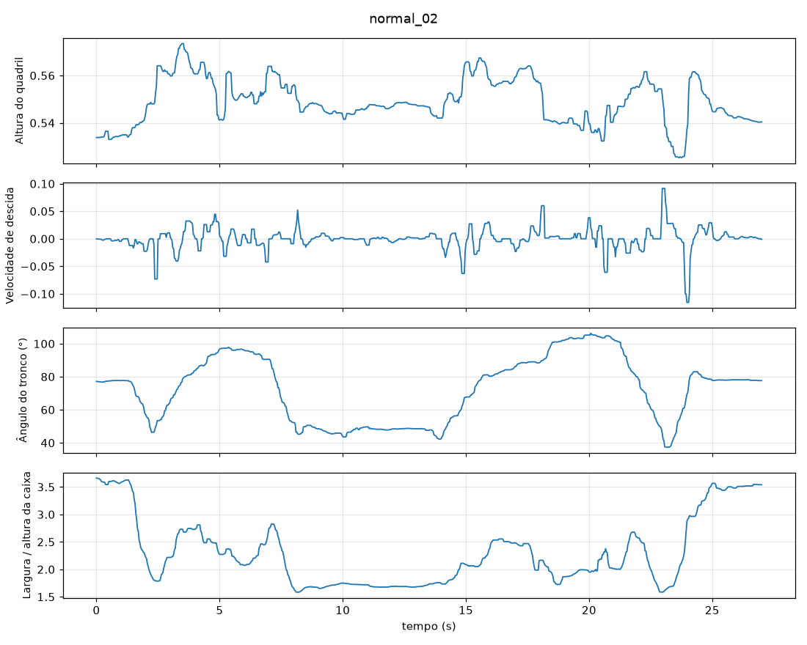

# Relatório de vídeo: normal_02

- Arquivo: `normal_02.mp4` (848x478, 30 fps, 27.0 s)
- Pessoa detectada em 100.0% dos quadros

**Conclusão:** Nenhum desvio detectado: o movimento ficou dentro do padrão esperado.

## Medidas ao longo do clipe

## Parâmetros da regra

- `queda_delta_altura`: 0.15
- `queda_janela_s`: 2.0
- `limiar_chao`: 0.35
- `tronco_min_graus`: 60
- `confirmacao_s`: 5.0
- `permanencia_min_s`: 3.0
