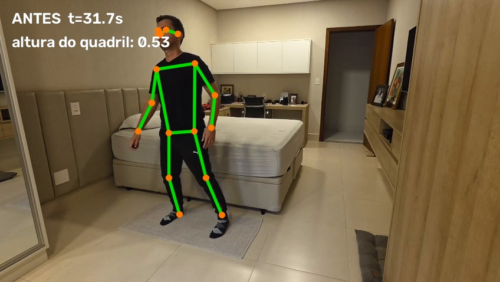
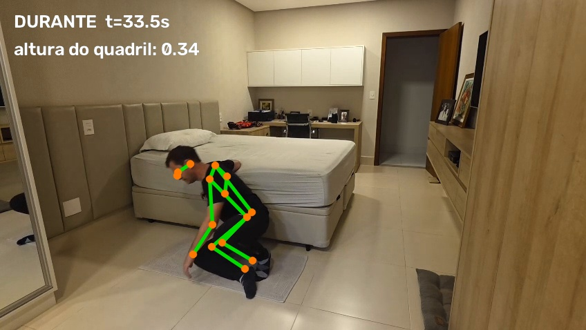
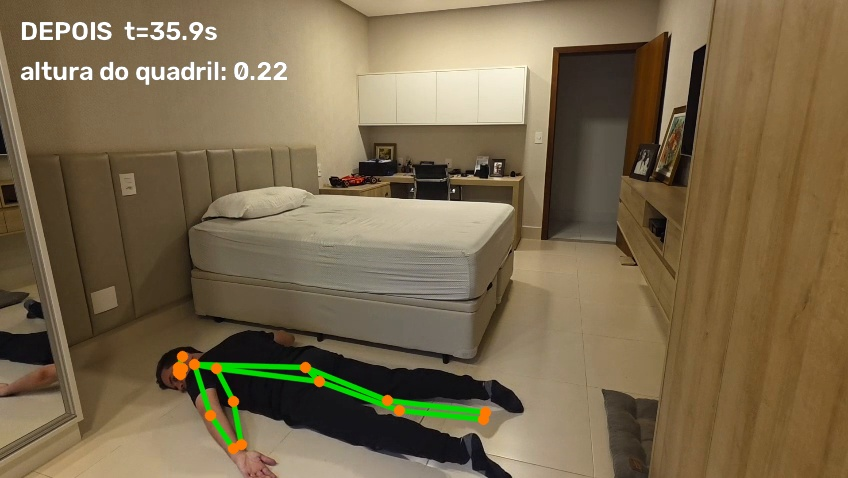
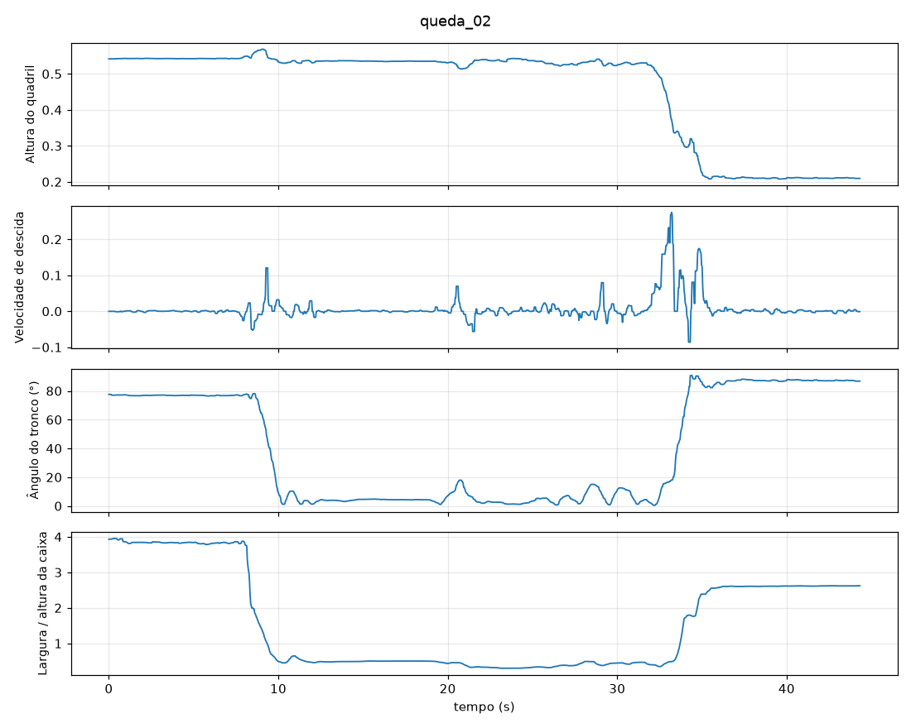

# Relatório de vídeo: queda_02

- Arquivo: `queda_02.mp4` (848x478, 30 fps, 44.3 s)
- Pessoa detectada em 100.0% dos quadros

**Conclusão:** 1 desvio detectado: queda às 10:31:58 (33.2 s do clipe), quadril no chão (0.22) por 10 s.

## Eventos

| Tipo | Instante no clipe | Horário fictício | Queda do quadril em 2 s | Altura final | Tronco | Permanência no chão |
|---|---|---|---|---|---|---|
| queda | 33.2 s | 2026-10-27 10:31:58 | 0.22 | 0.22 | 85° | 10 s |

### Quadros da queda 1

## Medidas ao longo do clipe

## Parâmetros da regra

- `queda_delta_altura`: 0.15
- `queda_janela_s`: 2.0
- `limiar_chao`: 0.35
- `tronco_min_graus`: 60
- `confirmacao_s`: 5.0
- `permanencia_min_s`: 3.0
